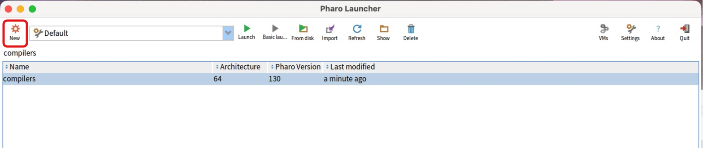
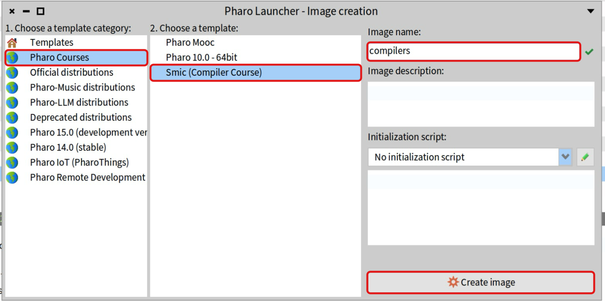
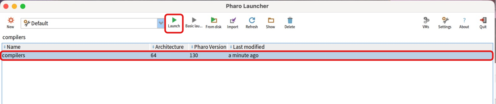
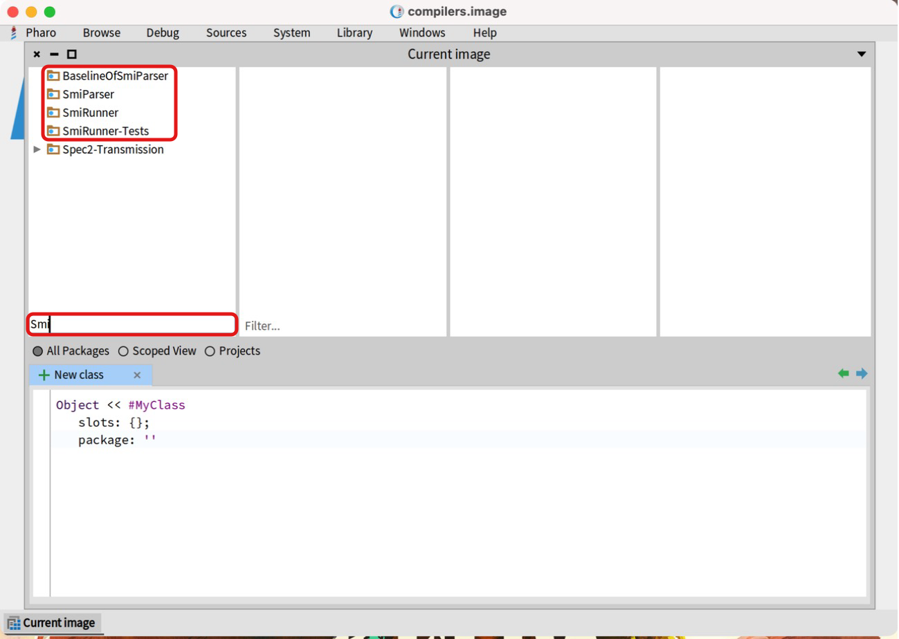
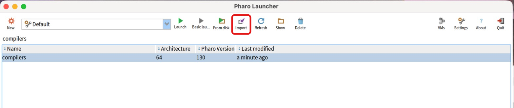

# Compilers — Admin Stuff

Lille — M2GL — Compilers. Course administration, schedule, evaluation, and communication.

## The Team

- **Romain Degrave** — PhD candidate @ Inria — security and languages
- **Federico Lochbaum** — PhD candidate @ Inria — performance and fuzzing
- **Guille Polito** — Researcher @ Inria — languages, VMs, testing…
- **Pablo Tesone** — Researcher @ Pharo Consortium — languages, VMs…

## Course Approach

A compiler course is a complex domain taught in a short time, so diving into a real-world compiler is not feasible. Instead we focus on:

- Fundamental concepts
- Exploring and learning lots of languages
- Concrete examples and exploration-based labs
- Observing real-world examples and reflecting on the code, not just writing it

If you are hungry for more, the course can be adapted.

## Getting the Course Image

All the labs run in one Pharo image that already has everything installed: Pharo 13, VMMaker, the course code (`Smi…` packages) and the native libraries the VM simulator needs (Unicorn and LLVM).

There are three ways to get it. **Try Option A first.** If something goes wrong, go to Option B, then Option C. Each one works on its own.

| Your machine | Supported? |
|---|---|
| Windows (Intel/AMD, 64-bit) | ✅ |
| Linux (Intel/AMD, 64-bit) | ✅ |
| macOS on Apple Silicon (M1, M2, M3…) | ✅ |
| macOS on Intel, Linux on ARM | ⚠️ The image opens, but the native libraries are missing. Tell us on Discord. |

> Not sure what your Mac has? Apple menu  → **About This Mac**: *Chip: Apple M…* means Apple Silicon, *Processor: Intel…* means Intel.

### Option A — Pharo Launcher (recommended)

1. **Install Pharo Launcher** from https://pharo.org/download (pick your operating system) and open it.

2. Click **New** in the top-left corner. The *Image creation* window opens.

   

3. In the *Image creation* window:
   1. Under **1. Choose a template category**, click **Pharo Courses**.
   2. Under **2. Choose a template**, click **Smic (Compiler Course)**.
   3. **Image name** is filled in for you. You can change it to something shorter, for example `compilers`.
   4. Click **Create image**.

   

   The Launcher downloads about 130 MB and unzips it, with a progress bar. It can take a few minutes. The first time, it also downloads the right Pharo virtual machine (VM).

4. When it is done, the image opens by itself in a new window titled `compilers.image` (or the name you chose), with a *Welcome to Pharo 13* window. You can close the Welcome window.

5. **Next times:** open Pharo Launcher, select your image in the list and click **Launch**. If the list is long, type the name of your image in the filter field above the list.

   

6. **Check that it works:** in the image window, open the **Browse** menu and click **System Browser**. In the first column of the browser there is a filter field at the bottom: type `Smi`. You should see the `SmiParser`, `SmiRunner` and `SmiRunner-Tests` packages.

   

Don't create a new image each time: your work lives in that image. Save it from the **Pharo** menu of the image window → **Save**.

### Option B — Download the image and import it into the Launcher

Use this if the download in step 3 above fails, or if you don't see **Smic (Compiler Course)** in the list.

1. Download the zip (about 130 MB):
   https://rmod-files.lille.inria.fr/?file=Lectures/Compiler-Course/CompilerCourse-v1.0.3.zip

2. Unzip it. You get a folder called `CompilerCourse`.
   **Keep that folder together.** The `.image` file needs the files next to it (`.changes`, `.sources`, the `libunicorn…` and `libLLVM…` libraries). Don't move the `.image` file out on its own.

3. In Pharo Launcher, click **Import** in the toolbar and choose `CompilerCourse.image` inside the unzipped folder.

   

4. Select the imported image in the list and click **Launch**. The Launcher picks the Pharo 13 VM by itself, because the folder has a `pharo.version` file.

5. Check that it works, as in step 6 of Option A.

### Option C — Without the Launcher

Use this if the Launcher does not work at all on your machine. You download the image and a Pharo 13 VM yourself and start the image from a terminal.

First, download and unzip the image as in Option B, steps 1 and 2.

**macOS and Linux.** Open a terminal and copy-paste these commands one by one. The first one must point to the folder you unzipped. Change the path if you did not unzip it in `Downloads`.

```bash
cd ~/Downloads/CompilerCourse
```

```bash
curl -fsSL https://get.pharo.org/64/vm130 | bash
```

```bash
./pharo-ui CompilerCourse.image
```

The second command downloads the Pharo 13 VM into the folder. You only need it once. Next time, only run the first and the last command.

**Windows.** Open **PowerShell** (Start menu → type `PowerShell`) and copy-paste these commands one by one. The first one must point to the folder you unzipped. Change the path if you did not unzip it in `Downloads`.

```powershell
cd $HOME\Downloads\CompilerCourse
```

```powershell
Invoke-WebRequest https://files.pharo.org/get-files/130/pharo-vm-Windows-x86_64-stable.zip -OutFile pharo-vm.zip
```

```powershell
Expand-Archive pharo-vm.zip -DestinationPath pharo-vm
```

```powershell
.\pharo-vm\Pharo.exe CompilerCourse.image
```

The second and third commands download and unzip the Pharo 13 VM. You only need them once. Next time, only run the first and the last command.

### Troubleshooting

- **The download fails in the Launcher** (for example an error about headers or a line that is too long): use Option B.
- **macOS says a library "cannot be opened because the developer cannot be verified"** (for example `libunicorn.2.dylib` or `libLLVM.dylib`): macOS blocks files downloaded with a browser. Run this in a terminal (change the path if needed), then start the image again:

  ```bash
  xattr -dr com.apple.quarantine ~/Downloads/CompilerCourse
  ```

- **macOS says "Pharo Launcher can't be opened"**: right-click the app → **Open** → **Open**. You only have to do this once.
- **Windows says "Windows protected your PC"**: click **More info** → **Run anyway**.
- **Still stuck?** Ask on Discord. Say which option you tried, your operating system, and paste the error message or a screenshot.

## Rough Agenda (1st part — can/may deviate)

| Date  | Topic |
|-------|-------|
| 04/11 | Intro and Stack Machines |
| 11/11 | Holidays — finish the exercises! |
| 18/11 | Tree -> Stack. Grammars and parsers |
| 25/11 | Register Machines. Tree -> Registers |
| 02/12 | Function Calls, calling conventions |
| 09/12 | Stack Frames |
| 16/12 | EXAM — amphitheater to confirm |

## Time Table (rough estimate)

- **8h–9h** — Theory: one lecture common for all groups
- **9h–9h15** — Break
- **9h15–12h** — Practice: each group in a different lab room

## Evaluation

```
CC * 0.5 + DS1 * 0.25 + DS2 * 0.25
```

Strong focus on practice and presence. Special circumstances are taken into account.

### Continuous Control (CC)

- Lots of practical exercises: coding, but not only
- Also exploring, understanding, explaining, drawing…
- Some optional, some mandatory
- Some on machine, some on paper
- Some may need to be done at home

### Exams (DS1, DS2)

- Written on paper
- Exercises similar to the practice sessions — very easy if you do the practices
- One at the end of the first period (estimated 16/12)
- One at the end of the last period (estimated 08/02)

## AI Policy

We all use AI. You use AI. We (the teachers) use AI. The real question is *do we use it right?*

- **As a person**, the goal is to become better: use AI to get further, not to skip the work.
- **As a teacher**, the goal is that you learn: use AI to learn, not just to produce answers.

AI should not just *do* for you — it should help you get further. Use it to explore, question, and understand; make sure you can explain and defend whatever you submit.

## Communication — Discord

Discord is the communication channel to find admin info, discuss topics, and ask questions.

- Find events (classes and their links, exams)
- General admin discussions, split per group
- One channel per topic

Join: https://discord.gg/fMqFeAgTV
